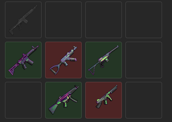
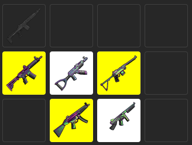

# Rust.scmm.app Colorblind Helper

This user script enhances the **Collections** page on [rust.scmm.app](https://rust.scmm.app) for users with red-green color blindness. It replaces the default red and green item highlights with a high-contrast yellow and white color scheme, making it much easier to see which items you own at a glance.

-----

## Features

  * 🎨 **High-Contrast Colors**: Changes the background highlight for owned items to **yellow** and unowned items to **white**.
  * ✅ **Automatic Activation**: The colorblind-friendly mode is enabled automatically when you visit your collections page.
  * toggler **Toggle On/Off**: A convenient button allows you to switch back to the site's original colors whenever you want.
  * legend **Simple Legend**: A small text label reminds you what the new colors mean.

-----

## Before & After

**Before:** The default red and green highlights can be difficult to distinguish.  
  

**After:** The new high-contrast yellow and white scheme is much clearer.  
  

-----

## ⚙️ Installation

To use this script, you first need a user script manager extension for your browser.

1.  **Install a Script Manager**: Download and install a browser extension like [Violentmonkey](https://violentmonkey.github.io/) (recommended) or [Tampermonkey](https://www.tampermonkey.net/).

2.  **Install the Script**: Click the link below to install the script. Your script manager will automatically open and prompt you to confirm the installation.

      * ### [➡️ Install Script from GitHub](https://github.com/Zuescho/RustSCCM-Colorblind/raw/main/SCCM%20for%20red-green%20blinds.user.js)

-----

## 📖 How to Use

Once installed, the script works automatically\!

  * Navigate to the **Inventory** -\> **Collections** tab on `rust.scmm.app`.
  * Your owned items will now have a **yellow** background.
  * If you wish to see the original colors, just click the **"Toggle Colors"** button that appears in the top-right corner of the page.

----
## Problems
This script isn't great; I'm not experienced in JavaScript. If the button doesn't appear, try reloading the site or toggling the script on and off in Violentmonkey. It should load after that. Also, the script might cause the whole site to lag. I tried to fix this in the latest version, but if your browser keeps freezing, just disable the script after you've looked through your collection.